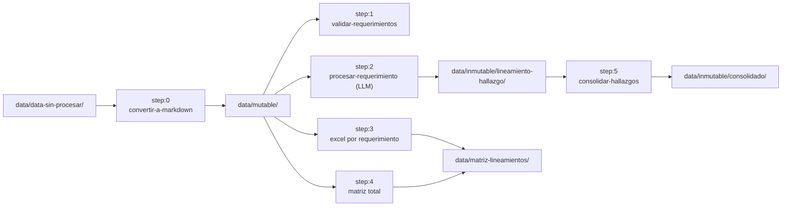

# Documentación — Proyecto DACI Lineamientos

Índice central del pipeline. Cada step tiene su propio `.md` con detalles; este documento ofrece la visión global, el mapa de scripts y los comandos para ejecutarlos.

## 1. Visión general

El proyecto es un pipeline de 6 pasos que toma documentos crudos (PDF, DOCX, XLSX, JSON, TXT) de requerimientos y lineamientos, los normaliza a Markdown, los valida, los analiza con un LLM (OpenAI `gpt-5-mini`) y emite varios Excel: por requerimiento, una matriz total y un consolidado global de hallazgos.



## 2. Mapa de scripts

| Step | Script principal | Qué hace | Entrada | Salida |
|---|---|---|---|---|
| 0 | [src/steps/0-convertir-a-markdown/index.js](../src/steps/0-convertir-a-markdown/index.js) | Convierte crudos a Markdown con front-matter | `data/data-sin-procesar/` | `data/mutable/{requerimientos,lineamientos}/` |
| 1 | [src/steps/1-validar-requerimientos/index.js](../src/steps/1-validar-requerimientos/index.js) | Valida estructura mínima de los MD | `data/mutable/` | Reporte por consola |
| 2 | [src/steps/2-procesar-requerimiento/index.js](../src/steps/2-procesar-requerimiento/index.js) | 1 llamada al LLM por par (requerimiento × lineamiento) | `data/mutable/` | `data/inmutable/lineamiento-hallazgo/<codigo>/<codigo>.xlsx` |
| 3 | [src/steps/3-generar-excel-por-requerimiento/index.js](../src/steps/3-generar-excel-por-requerimiento/index.js) | Excel con lineamientos por requerimiento | `data/mutable/` | `data/matriz-lineamientos/req_<codigo>.xlsx` |
| 4 | [src/steps/4-generar-matriz-total-lineamientos/index.js](../src/steps/4-generar-matriz-total-lineamientos/index.js) | Matriz Excel total de lineamientos | `data/mutable/lineamientos/` | `data/matriz-lineamientos/matriz-total-lineamientos.xlsx` |
| 5 | [src/steps/5-consolidar-hallazgos/index.js](../src/steps/5-consolidar-hallazgos/index.js) | Une todos los xlsx de hallazgos | `data/inmutable/lineamiento-hallazgo/` | `data/inmutable/consolidado/consolidado.xlsx` |

### Sub-scripts del Step 0
- [`convertir-requerimiento.js`](../src/steps/0-convertir-a-markdown/convertir-requerimiento.js): convierte cada archivo crudo de `data-sin-procesar/requerimientos/` a `<codigo>.md`.
- [`convertir-lineamiento.js`](../src/steps/0-convertir-a-markdown/convertir-lineamiento.js): convierte cada archivo dentro de `req_<codigo>/` a un `.md` por lineamiento.
- [`convertir-plan.js`](../src/steps/0-convertir-a-markdown/convertir-plan.js): placeholder (no-op por ahora, queda como gancho).

## 3. Comandos npm

| Comando | Descripción | Prerequisitos |
|---|---|---|
| `npm run generar:requerimientos` | Solo sub-convertidor de requerimientos del Step 0 | — |
| `npm run generar:lineamientos` | Solo sub-convertidor de lineamientos del Step 0 | — |
| `npm run step:0` | Convertir crudo a Markdown (los 3 sub-scripts) | Archivos en `data/data-sin-procesar/` |
| `npm run step:1` | Validar estructura de requerimientos | Step 0 ejecutado |
| `npm run step:2` | Analizar con LLM (`gpt-5-mini`) | `OPENAI_API_KEY` en `.env`, Step 0 |
| `npm run step:3` | Excel por requerimiento | Step 0 |
| `npm run step:4` | Matriz total de lineamientos | Step 0 |
| `npm run step:5` | Consolidar hallazgos en un Excel global | Step 2 |
| `npm run pipeline` | Corre `0 → 1 → 2 → 3 → 4 → 5` | `OPENAI_API_KEY` en `.env` |

### Flags útiles

Cualquier comando acepta flags vía CLI. Para pasarlos por npm usar `--`:

| Flag | Step | Efecto |
|---|---|---|
| `--solo=<codigo>` | 2 | Procesa un único requerimiento (ej. `--solo=5.3.1.14`) |
| `--solo=requerimientos` | 0 | Solo sub-convertidor de requerimientos |
| `--solo=lineamientos` | 0 | Solo sub-convertidor de lineamientos |
| `--solo=plan` | 0 | Solo sub-convertidor `convertir-plan` |
| `--dry-run` | 2 | No llama al LLM; genera filas placeholder |

Ejemplos:
```bash
npm run step:2 -- --solo=5.3.1.14
npm run step:2 -- --dry-run
```

## 4. Convenciones

- **Código de requerimiento**: jerárquico tipo `1.1.1.1` o `5.3.1.14`.
- **Carpeta de lineamientos**: `req_<codigo>` (ej. `req_5.3.1.14`).
- **Front-matter**: cada MD generado incluye YAML con metadatos (`codigo`, `titulo`, `fuente`, etc.).
- **Idempotencia**: `data/mutable/` y `data/matriz-lineamientos/` se regeneran en cada corrida.

## 5. Cómo ejecutar (end-to-end)

```bash
# 1. Instalar dependencias
npm install

# 2. Configurar credenciales
cp .env.example .env
# editar OPENAI_API_KEY

# 3. Colocar archivos crudos en data/data-sin-procesar/
#    - requerimientos/<archivos>
#    - lineamientos_requerimiento/req_<codigo>/<archivos>

# 4a. Opción A: pipeline completo
npm run pipeline

# 4b. Opción B: paso a paso
npm run step:0
npm run step:1
npm run step:2          # requiere OPENAI_API_KEY
npm run step:3
npm run step:4
npm run step:5
```

## 6. Detalle por step

- [Step 0 — Convertir a Markdown](step-0-convertir-a-markdown.md)
- [Step 1 — Validar requerimientos](step-1-validar-requerimientos.md)
- [Step 2 — Procesar requerimiento (LLM)](step-2-procesar-requerimiento.md)
- [Step 3 — Generar Excel por requerimiento](step-3-generar-excel-por-requerimiento.md)
- [Step 4 — Generar matriz total de lineamientos](step-4-generar-matriz-total-lineamientos.md)
- [Step 5 — Consolidar hallazgos](step-5-consolidar-hallazgos.md)

## 7. Estructura de datos

```
data/
├── data-sin-procesar/                       Entrada (crudos)
│   ├── requerimientos/                      Un archivo crudo por requerimiento
│   └── lineamientos_requerimiento/
│       └── req_<codigo>/                    Lineamientos asociados al requerimiento
├── mutable/                                 Salida regenerable (Step 0)
│   ├── requerimientos/<codigo>/<codigo>.md
│   └── lineamientos/req_<codigo>/<id>.md
├── matriz-lineamientos/                     Salida de Steps 3 y 4
│   ├── req_<codigo>.xlsx
│   └── matriz-total-lineamientos.xlsx
└── inmutable/                               Salidas auditables (Steps 2 y 5)
    ├── lineamiento-hallazgo/<codigo>/<codigo>.xlsx
    └── consolidado/consolidado.xlsx
```

## 8. Columnas canónicas de hallazgos (Steps 2 y 5)

| Columna | Descripción |
| --- | --- |
| `n_req` | Código del requerimiento |
| `requerimiento` | Texto del requerimiento |
| `lineamiento_1` | Texto del lineamiento analizado |
| `lineamiento_2` | `null` (reservado) |
| `lineamiento_3` | `null` (reservado) |
| `razonamiento_previo` | Análisis del LLM |
| `tipo_hallazgo` | `Observación` \| `Oportunidad de mejora` \| `Cumple` |
| `criterio_afectado` | Inconsistencia Lógica \| Coherencia Literal \| Validación Matemática \| Completitud \| Vigencia Terminológica \| N/A |
| `hallazgo` | Título + descripción detallada |
